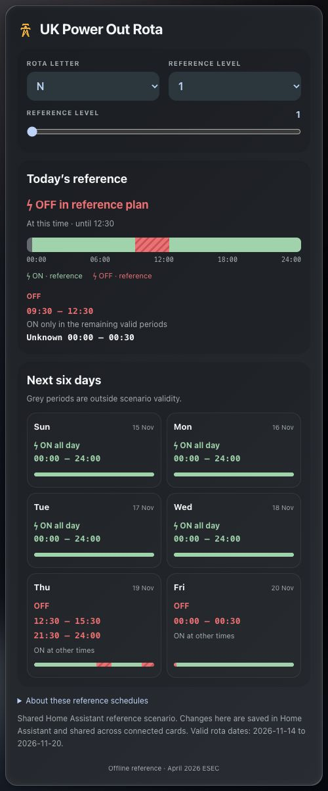

# UK Power Out Rota

Offline April 2026 ESEC reference rota card for Home Assistant: 18 load blocks, levels 1–18, instant level slider, editable dropdowns, today's reference timeline and a six-day outlook.



**Hypothetical reference scenarios only.** A selected level does not establish NESO activation or an actual power cut. ON means no disconnection in the reference table, not guaranteed supply. Follow your network operator's published instructions and actual activation schedules.

## Install

Requires Home Assistant 2026.11.0 or newer.

Add `https://github.com/sarn-online/uk-power-out-card` to Marketplace → Custom repositories, category **Dashboard**. On older HACS installations the category is also Dashboard (`plugin` internally). Install the card and reload your browser. Custom repository installation is separate from acceptance into the default catalog.

[Open the card repository in your Home Assistant](https://my.home-assistant.io/redirect/marketplace_repository/?owner=sarn-online&repository=uk-power-out-card&category=plugin)

For manual installation, copy `power-out-card.js` to `<config>/www/`, then add `/local/power-out-card.js?v=1.1.0` as a JavaScript module in Settings → Dashboards → Resources. Update that URL when replacing a manually installed version. Do not load both manual and Marketplace copies.

UI-managed dashboards normally receive the Marketplace resource automatically. For YAML-managed resources:

```yaml
resources:
  - url: /local/community/uk-power-out-card/power-out-card.js
    type: module
```

## Add the card

Edit dashboard → Add card → UK Power Out, or use:

```yaml
type: custom:power-out-card
title: UK Power Out Rota
rota: N
level: 1
storage_key: power-out
```

`N` is an example. Confirm your load-block letter with your electricity network operator. [Power Cut 105](https://www.powercut105.com/) can help identify the operator; some bills also show a rota/load-block letter. Do not confuse it with the MPAN or meter number. A reference level is a scenario selection, not a household identifier or live reading.

| Setting | Default | Meaning |
| --- | --- | --- |
| `type` | required | `custom:power-out-card` |
| `title` | `UK Power Out Rota` | Panel heading |
| `icon` | `mdi:transmission-tower` | Heading icon |
| `rota` | empty | A B C D E G H J K L M N P Q R S T U |
| `level` | `1` | Integer reference level 1–18 |
| `storage_key` | `default` | Separates standalone preferences; maximum 100 characters |
| `entity` | omitted | Optional Power Out reference sensor for shared settings |

Both the dropdown and slider change the level. The schedule redraws immediately; controls retain focus while sliding or using the keyboard.

## Standalone or shared settings

Without `entity`, the card runs entirely locally. Choices are remembered in this browser and override YAML defaults. A different `storage_key` starts separate preferences. No integration, helpers, cloud account or service calls are needed in standalone mode.

For settings shared across devices and real Home Assistant reference sensor entities, install the companion [UK Power Out integration](https://github.com/sarn-online/uk-power-out) and use its actual reference supply entity ID:

```yaml
type: custom:power-out-card
title: UK Power Out Rota
entity: sensor.power_out_reference_supply
```

You can enter the entity in the visual editor. IDs may have suffixes for multiple scenarios. Connected cards ignore browser-saved choices: dropdowns and the slider save through `power_out.set_scenario`. Only the selected field changes; the other choice, plan type and validity dates are preserved. Rapid input previews immediately, with background saves retaining the latest value. A failed save rolls back that choice and displays an error. Standard Home Assistant entity-control permissions apply.

Edit validity dates in Settings → Devices & services → Helpers → Power Out reference supply → Settings → Power Out options. Shared-scenario information and dates appear at the bottom. Periods outside those dates are grey/unknown. A missing, unavailable or incompatible entity shows a message without falling back to an outage prediction. Remove `entity` to return to standalone mode.

## Times and limitations

Times use Europe/London, wherever the browser or Home Assistant is located. Eight nominal three-hour rota periods start at 00:30; midnight–00:30 belongs to the preceding rota day. `24:00` is the end of the displayed civil day. Clock changes alter elapsed slot duration. In shared mode the selected first rota date starts at 00:30, and the inclusive last rota date ends at 00:30 the following day; the card never extends it automatically.

These are Annex 2 **Variable Rota** reference tables. Low-Level plans and actual NESO activation schedules cannot be inferred from them. Protected sites, local conditions and official schedules take precedence. No postcode lookup, telemetry, active-level detection or physical supply measurement is performed. Home Assistant must still be reachable; this is not an emergency notification service.

## Development

Node.js 20 or newer; no dependencies or bundler:

```sh
npm run build
npm run check
npm test
```

Tests compare 18,144 compiled source cells and 3,265,920 civil minutes across all 324 rota/level combinations, plus clock changes, rendering, persistence, validation, escaping, fast slider saves, stale acknowledgements and failed-save rollback. [Source validation](SOURCE-VALIDATION.md) documents six PDF/workbook discrepancies. GitHub Actions run these tests and official HACS validation; check their actual results before releasing.

## Source and licence

DESNZ, *Electricity Supply Emergency Code*, revised April 2026, Annexes 1–2. [Official publication](https://www.gov.uk/government/publications/electricity-supply-emergency-code). Contains public sector information under the [Open Government Licence v3.0](https://www.nationalarchives.gov.uk/doc/open-government-licence/version/3/). Code: MIT. See [NOTICE.md](NOTICE.md) and [LICENSE](LICENSE). Independent project; no government, NESO or Home Assistant affiliation.
