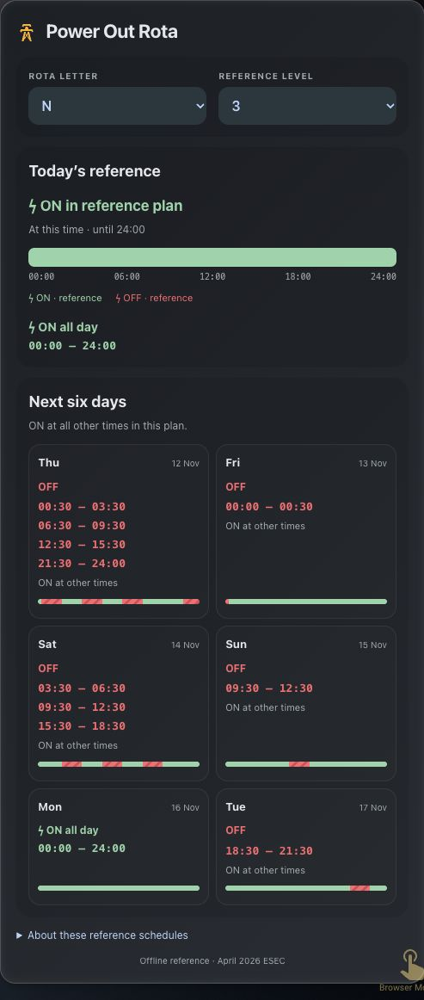

# UK Power Out

An offline **ESEC reference rota card for Home Assistant**, with exact OFF times and a compact six-day outlook.



**Reference scenarios only.** Selecting a level does not mean it is active, and the card does not confirm an outage or your actual supply. ON means no disconnection in the published reference table. Check your network operator for confirmed restrictions. This is an independent community project.

## Where do I find my rota letter and level?

**Rota letter:** enter your postcode at [Power Cut 105](https://www.powercut105.com/), which directs you to your local electricity network operator. Some electricity bills also show a **rota block letter**, **load block letter**, or **rota disconnections alpha identifier**. If it is missing or unclear, ask your distribution network operator to confirm it. Do not guess from neighbouring addresses or confuse it with your meter number or MPAN.

**Reference level (1–18):** choose a level to explore the ESEC reference scenarios. It is not a household account number, is not obtained from your rota letter, and is not calculated from live grid data. During an emergency, follow official announcements and your network operator's published postcode-specific restrictions. Only use a level as an applicable scenario if official instructions identify it; if they publish specific times instead, those times take precedence. If no official level is announced, there is no confirmed active level supplied by this card—even when its dropdown shows a number.

The card does not look up postcodes or detect an active level. Official guidance: [GOV.UK power cuts](https://beready.campaign.gov.uk/be-informed-about-hazards/power-cuts/) and [ESEC guidance](https://www.gov.uk/government/publications/electricity-supply-emergency-code).

## Features

- All 18 reference levels and 18 rota letters from the April 2026 ESEC PDF.
- Simple letter and number dropdowns; selections remembered on each browser.
- Today's reference status, a green/red timeline and exact red OFF ranges.
- The next six days in a two-column grid, with OFF ranges visible without tapping.
- UK clock times, correct midnight carry-over, and daylight-saving handling.
- Dark charcoal design with a pylon icon; keyboard-accessible native controls.
- Visual configuration editor and no third-party JavaScript dependencies.
- No Home Assistant helpers, service calls, cloud APIs, telemetry or tokens.

[](https://my.home-assistant.io/redirect/marketplace_repository/?owner=sarn-online&repository=uk-power-out-card&category=plugin)

## Install through Marketplace or HACS

This repository is not yet in the default Marketplace catalog. You can install it now as a custom repository.

Add `https://github.com/sarn-online/uk-power-out-card` in **Marketplace → menu → Custom repositories**, selecting **Dashboard** (called `plugin` internally), and install Power Out. On older installations using HACS, use its Custom repositories screen and the same category.

After catalog acceptance, users can search for **Power Out** directly. Reload the browser after installation. Marketplace adds the JavaScript resource automatically on UI-managed dashboards. YAML-managed resources need:

```yaml
resources:
  - url: /local/community/uk-power-out-card/power-out-card.js
    type: module
```

The path assumes the published repository is named `uk-power-out-card`.

### Manual installation

1. Download `power-out-card.js` from the GitHub release, or use `power-out-card.js` from this package.
2. Copy it to `<config>/www/power-out-card.js`.
3. In **Settings → Dashboards → menu → Resources**, add `/local/power-out-card.js?v=1.0.0` as a **JavaScript module**.
4. Reload the browser. If you created `www` for the first time, restart Home Assistant once.

Do not load a manual and a Marketplace copy at the same time. Remove the manual resource when migrating, then reload.

## Add the card

**Edit dashboard → Add card → By card → Power Out.** Use the visual editor or paste:

```yaml
type: custom:power-out-card
title: Power Out
rota: N
level: 1
storage_key: power-out
```

`N` is an example, not a location lookup. Confirm your load-block letter from your electricity bill or network operator. To require a choice, omit `rota`.

| Setting | Default | Meaning |
|---|---|---|
| `type` | required | `custom:power-out-card` |
| `title` | `Power Out` | Card heading |
| `icon` | `mdi:transmission-tower` | Home Assistant icon |
| `rota` | empty | A, B, C, D, E, G, H, J, K, L, M, N, P, Q, R, S, T, U |
| `level` | `1` | Integer reference scenario, 1–18 |
| `storage_key` | `default` | Preference identifier, maximum 100 characters |

### Saved choices

Choices are saved in this browser's local storage, not as Home Assistant entities. Different devices choose their settings independently. Stored choices override YAML defaults. Use a different `storage_key` to start fresh or separate multiple cards. The card refreshes its time display every minute.

## Reading the times

- Green **ON**: no disconnection in this reference plan; electricity is not guaranteed.
- Red, striped **OFF**: disconnected in the reference table; not a confirmed restriction.
- All clock labels use **Europe/London**, even if your device is abroad.
- `24:00` means the end of the displayed day. Midnight–00:30 belongs to the previous rota day's final period.
- Reference periods are nominally three hours. Spring/autumn clock changes alter their elapsed duration.
- Official indicative plans, implementation plans and activation schedules, protected sites and local network arrangements can differ.

The schedules run locally once the card is loaded. Your device still needs access to Home Assistant or its cached frontend; this does not make Home Assistant an offline emergency notification system.

## Compatibility

Minimum declared version: Home Assistant **2026.11.0**, the version used for live verification. Uses standard custom-card APIs and modern JavaScript. Earlier versions have not been verified.

## Development and validation

No dependency installation is needed. Use Node.js 20 or newer:

```sh
npm run build
npm run check
npm test
```

`power-out-card.js` is both the readable source and installable module. No bundler or external dependencies are required. The build command checks its syntax.

Tests compare 18,144 source cells and every civil minute of all 324 rota/level scenarios against an independent PDF fixture. They also cover UK DST, the six-day grid, settings, persistence and HTML escaping. See [source validation and known discrepancies](SOURCE-VALIDATION.md).

GitHub Actions are configured for the tests and official HACS validation; see the Actions tab for their actual status. A published repository is not catalog acceptance. [Publishing checklist](PUBLISHING.md).

## Source and licence

Source: DESNZ, Electricity Supply Emergency Code, revised April 2026, Annex 2. Contains public sector information licensed under the Open Government Licence v3.0. Code: MIT. See [NOTICE.md](NOTICE.md) for attribution and [LICENSE](LICENSE).
